# Data Engineering Practical Assessments — NYC Yellow Taxi

Two independent, locally runnable solutions built on the public
[NYC TLC Yellow Taxi trip records](https://www.nyc.gov/site/tlc/about/tlc-trip-record-data.page).

This repository covers batch ingestion, data quality, warehouse modelling, real-time event processing,
analytics, and operational monitoring. The screenshots below show captured runs of the local application;
counts, statuses, and timings vary between runs.

[Workflows and architecture](#workflows-and-architecture) · [Getting started](#getting-started) · [Local services](#local-services) · [Screenshots](#screenshots) · [Tests](#tests) · [Key assumptions](#key-assumptions-details-in-each-readme)

For assessment handover, see the [requirements review](REQUIREMENTS_REVIEW.md),
including verified results and remaining streaming reliability gaps.

| | Assignment 1 — Batch | Assignment 2 — Streaming |
|---|---|---|
| Folder | [`assignment-1-batch-etl/`](assignment-1-batch-etl/README.md) | [`assignment-2-streaming/`](assignment-2-streaming/README.md) |
| Flow | TLC parquet → Prefect ETL → PostgreSQL star schema → Streamlit | TLC parquet → Python producer → 3-broker Kafka → Python stream processor → TimescaleDB |
| Highlights | Partitioned star schema, 10 data-quality rules, idempotent transactional loads, retries + failure alerts, structured JSON logs, run audit table | Event-time sliding windows with watermarks, out-of-order & late-event handling, idempotent sink (effectively-once), DLQ, backpressure, Prometheus + Grafana, 50k ev/s production design |
| Run | `./setup.sh` → `python -m flows.taxi_etl_flow run` → `streamlit run dashboard/app.py` | `docker compose up -d --build` → Grafana on `localhost:3300` |

```
.
├── run_all.sh                   # starts everything + the verification console
├── run_all.ps1                  # Windows PowerShell launcher
├── images/                      # screenshots embedded in this README
├── verification-ui/             # live verification console (HTML/CSS page + stdlib Python checks)
├── data/                        # shared: raw downloads (data/raw) and rejected rows (data/rejected) - git-ignored
├── assignment-1-batch-etl/      # setup.sh, schema.sql, ETL package, Prefect flow, Streamlit dashboard, tests
└── assignment-2-streaming/      # docker-compose (Kafka x3, TimescaleDB, Prometheus, Grafana), producer, processor, tests
```

## Workflows and architecture

Each diagram includes an SVG image and expandable Mermaid code. Open the image for a larger view.

### Assignment 1: batch ETL workflow

The Prefect flow processes each configured month, isolates failed monthly loads, and refreshes analytics after successful loads.


<details>
<summary>Mermaid source</summary>

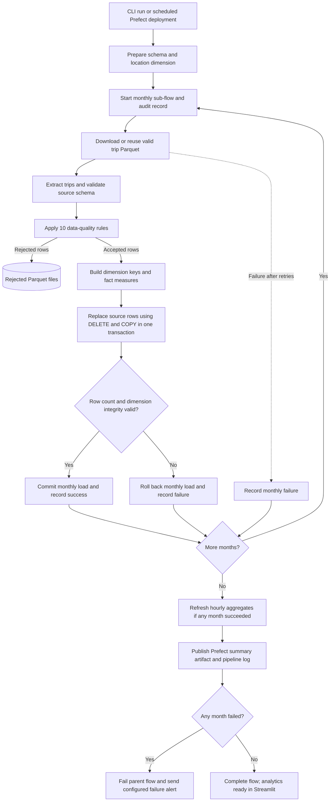

</details>

[Edit Mermaid source](images/diagrams/assignment-1-workflow.mmd)

### Assignment 1: batch ETL architecture

The batch application runs in Python, PostgreSQL runs in Docker, and Streamlit serves warehouse aggregates. Dashed arrows show orchestration or operational checks.


<details>
<summary>Mermaid source</summary>

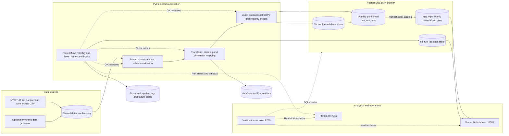

</details>

[Edit Mermaid source](images/diagrams/assignment-1-architecture.mmd)

### Assignment 2: streaming workflow

The processor stores validated raw events, aggregates only newly inserted on-time events, and commits Kafka offsets after the database transaction. Late events remain in raw storage without updating window totals; duplicate events do not increment aggregates. Invalid payloads go to the dead-letter topic.


<details>
<summary>Mermaid source</summary>

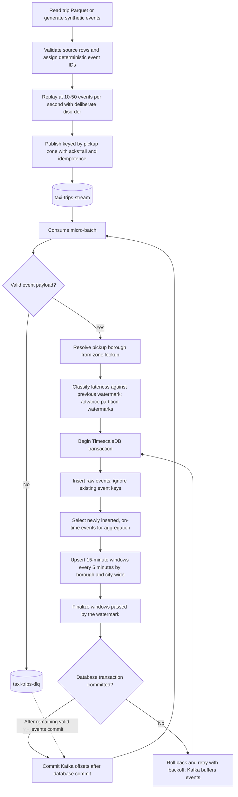

</details>

[Edit Mermaid source](images/diagrams/assignment-2-workflow.mmd)

### Assignment 2: streaming architecture

The local Docker stack uses three Kafka brokers, Python producer and processor services, TimescaleDB, and an observability stack. This diagram describes the implemented local deployment; the production scaling proposal is documented in the streaming README.


<details>
<summary>Mermaid source</summary>

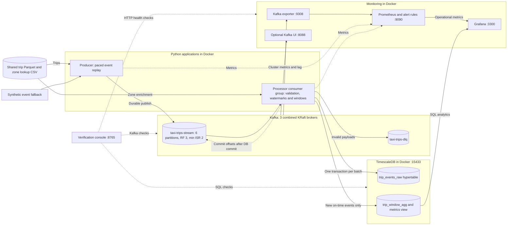

</details>

[Edit Mermaid source](images/diagrams/assignment-2-architecture.mmd)

## Getting started

Requirements: Docker with Compose v2, Python ≥ 3.10, Bash, and `curl`. On Windows, use Git Bash or WSL
for `setup.sh`. Start Docker before running setup. The launchers require the batch virtual environment
and initial setup to exist.

### First-time setup

```bash
# From the repository root: create the environment, start PostgreSQL,
# download the shared data, and apply the database schema.
cd assignment-1-batch-etl
./setup.sh
cd ..
```

For an offline data demo, use `./setup.sh --synthetic` instead. Dependency installation and Docker image
downloads still need network access unless already cached.

### Run each assignment separately

```bash
# Assignment 1: load the warehouse, then start the analytics dashboard.
cd assignment-1-batch-etl
source .venv/bin/activate          # Windows Git Bash: source .venv/Scripts/activate
python -m flows.taxi_etl_flow run
streamlit run dashboard/app.py     # keeps this terminal occupied
```

In a second terminal, start the streaming stack from the repository root:

```bash
cd assignment-2-streaming
docker compose up -d --build
# Include the optional Kafka UI:
docker compose --profile ui up -d
```

### Run everything and verify it

```bash
./run_all.sh            # PostgreSQL, Prefect UI, Kafka/streaming stack + Kafka UI, Streamlit, then the console on :8765
./run_all.sh --etl      # use for the first run to populate the batch warehouse; also supports reruns
./run_all.sh --stop     # stop all containers
```

On Windows, the PowerShell launcher does the same, also starts Docker Desktop if needed, and keeps the UIs running
after the terminal closes:

```powershell
powershell -ExecutionPolicy Bypass -File .\run_all.ps1          # start everything + open all UIs in the browser
powershell -ExecutionPolicy Bypass -File .\run_all.ps1 -Etl     # also (re)run the batch ETL first
powershell -ExecutionPolicy Bypass -File .\run_all.ps1 -Stop    # stop UIs and containers (data is kept)
```

The [verification console](verification-ui/README.md) runs 41 live checks across both assignments (schema, row
reconciliation, referential integrity, Kafka replication and consumer lag, idempotent sink, window correctness,
Prometheus/Grafana health) and shows the evidence for each.

Allow the stream about a minute to produce data, then open the verification console and select **Run checks**.
The Bash launcher's `--stop` option stops containers; use Ctrl+C to stop its foreground verification console.
The PowerShell `-Stop` option also stops the Python UI processes.

## Local services

These addresses use the default configuration. Both root launchers start the optional Kafka UI.

| Service | Address / host port | Purpose |
|---|---|---|
| Verification console | [localhost:8765](http://localhost:8765) | Run checks across both assignments |
| Streamlit | [localhost:8501](http://localhost:8501) | Batch trip analytics |
| Prefect | [localhost:4200](http://localhost:4200) | Flow runs, tasks, and orchestration history |
| Grafana | [localhost:3300](http://localhost:3300) | Streaming dashboard; default login `admin` / `admin` |
| Prometheus | [localhost:9090/targets](http://localhost:9090/targets) | Metrics targets and alert rules |
| Kafka UI | [localhost:8088](http://localhost:8088) | Brokers, topics, and consumer groups |
| PostgreSQL | `localhost:15432` | Batch warehouse |
| TimescaleDB | `localhost:15433` | Raw stream events and window aggregates |
| Kafka brokers | `localhost:9092–9094` | Kafka client connections |
| Producer metrics | [localhost:8000/metrics](http://localhost:8000/metrics) | Producer Prometheus metrics |
| Kafka exporter | [localhost:9308/metrics](http://localhost:9308/metrics) | Broker and consumer metrics |

## Screenshots

### Pipeline verification

The console groups checks by batch processing, Kafka, streaming, and observability. This captured run
reports **39 passed, 0 warnings, 0 failed, and 2 informational checks**.

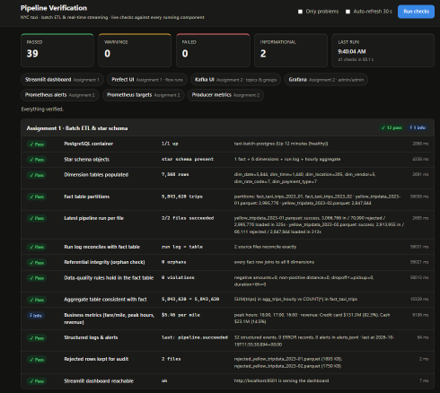

Kafka checks cover broker health, replication, topic configuration, and consumer assignment.
Streaming checks cover throughput, delivery, latency, stored events, and window aggregates.

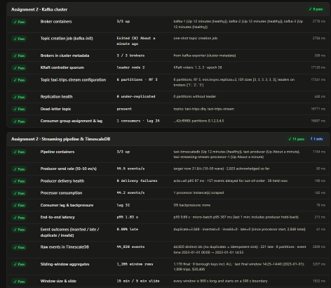

Additional checks inspect window consistency, the dead-letter queue, Prometheus, Grafana, Prefect, and Kafka UI.

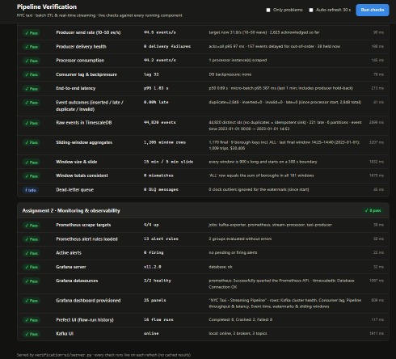

### Batch analytics in Streamlit

The dashboard supports pickup-date and borough filters, with trip count, revenue, fare per mile,
average trip metrics, and card tip rate. Charts compare fare per mile by borough and revenue by payment type.

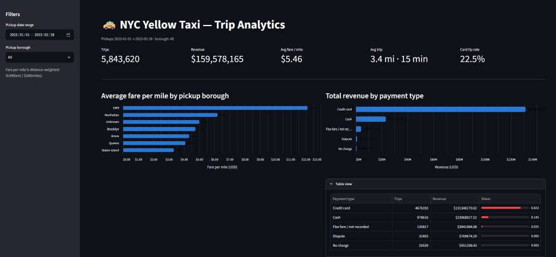

Hourly trip volumes and a weekday/hour heatmap show demand patterns. The pipeline-run table records
source files, run status, duration, and extracted, rejected, and loaded row counts.

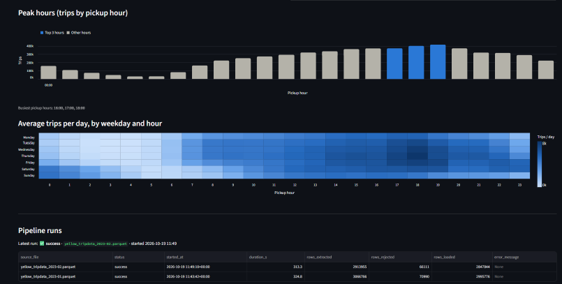

### Prefect orchestration

The Runs page displays batch flows and monthly sub-flows with their recorded statuses.

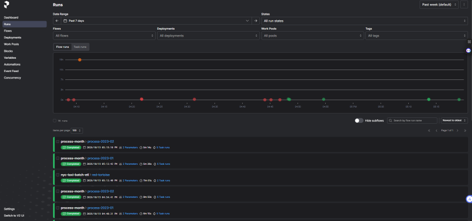

The overview shows flow and task activity, including completed and failed historical attempts.

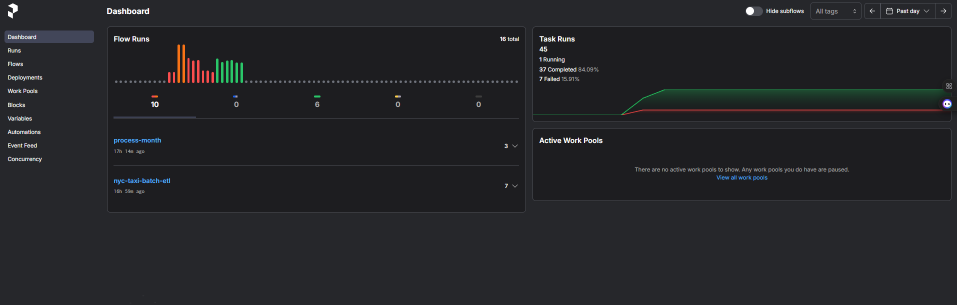

### Grafana streaming dashboard

Cluster panels display broker availability, replication, scrape status, topic write rate, and consumer lag.
This capture includes a down scrape target alongside healthy targets; it reflects the state at capture time.

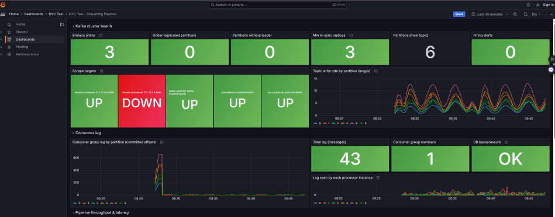

Throughput and latency panels compare production and consumption rates, event outcomes,
end-to-end latency, micro-batch duration, and producer delivery latency.

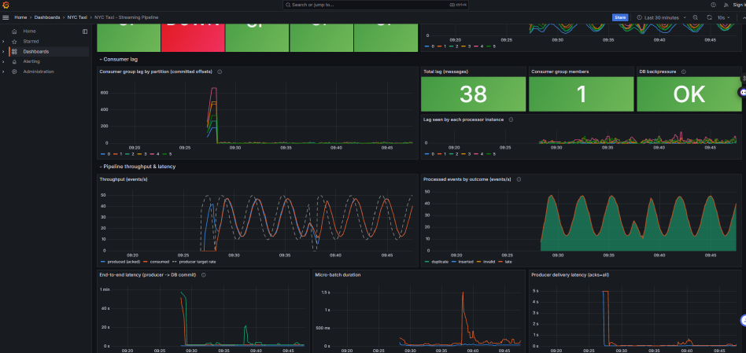

Event-time panels show the watermark, out-of-order events, dead-letter count, sliding-window results,
and raw-event storage totals. The local windows are 15 minutes wide with a 5-minute slide.

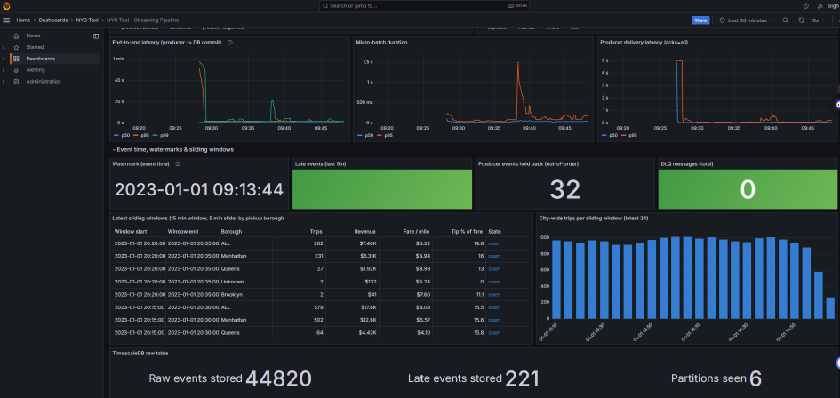

### Prometheus targets

The Targets page shows scrape health for Kafka exporter, Prometheus, the stream processor, and the producer.
All four targets are up in this separate capture.

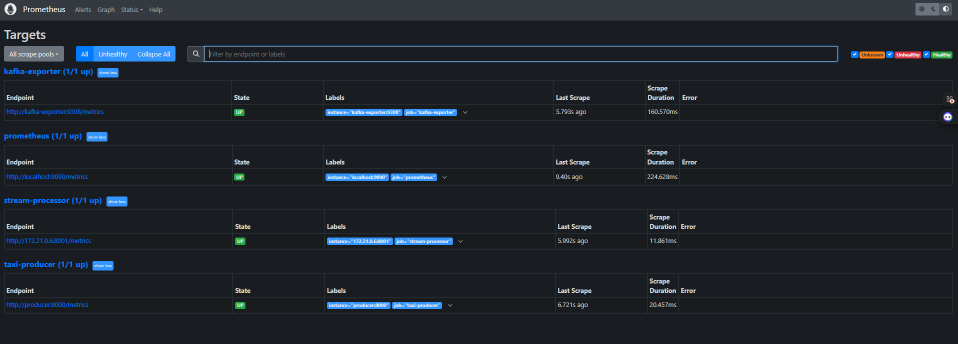

### Kafka UI

The cluster overview provides broker, partition, topic, and traffic information for the local Kafka cluster.

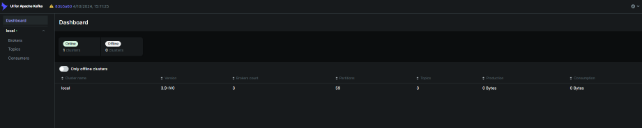

## Tests

Run the batch transformation tests in the batch environment:

```bash
cd assignment-1-batch-etl
source .venv/bin/activate          # Windows Git Bash: source .venv/Scripts/activate
pytest
```

Run the streaming event-contract and windowing tests in a separate environment:

```bash
cd assignment-2-streaming         # from the repository root
python -m venv .venv
source .venv/bin/activate          # Windows Git Bash: source .venv/Scripts/activate
python -m pip install -r requirements.txt pytest
pytest
```

Use the [verification console](verification-ui/README.md) for live integration checks after starting the services.
For architecture, configuration, SQL, and operational details, see the
[batch README](assignment-1-batch-etl/README.md) and [streaming README](assignment-2-streaming/README.md).

## Key assumptions (details in each README)

* **Data:** yellow taxi trips for 2023-01 and 2023-02 (configurable). If the download isn't possible,
  `assignment-1-batch-etl/setup.sh --synthetic` generates realistic data with the same schema (including dirty rows),
  and the streaming producer falls back to a synthetic generator.
* **Revenue** = `total_amount`; negative-amount rows are refunds/voids and are excluded from analytics.
* **Fare per mile** is distance-weighted (`SUM(fare) / SUM(miles)`), not an average of per-trip ratios.
* **Event time** for streaming = trip drop-off time; events are replayed at 10–50 events/s with deliberate disorder.
* **Local footprint:** single PostgreSQL / TimescaleDB instance, 3 combined KRaft Kafka nodes with 512 MB heaps.
  Every component can also be started stage by stage (see the Assignment 2 README).
