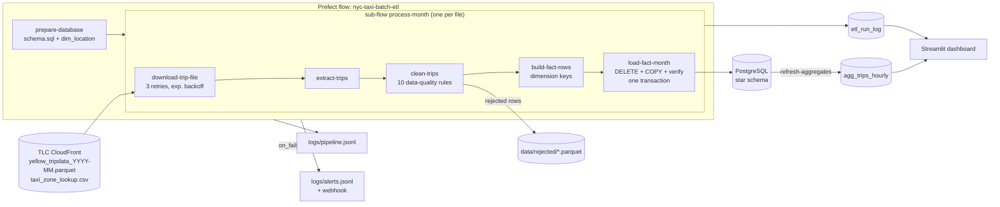
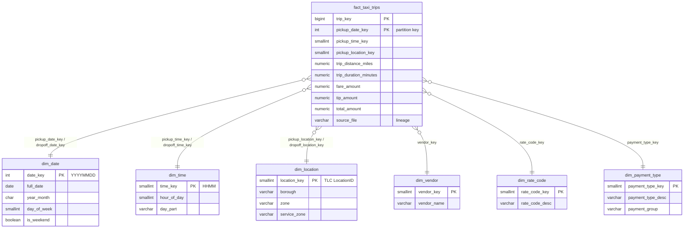

# Assignment 1 — Batch ETL: NYC Yellow Taxi → PostgreSQL Star Schema

A local, automated batch pipeline that downloads NYC TLC yellow-taxi trip data, cleans it, models it as a
star schema in PostgreSQL, and serves the key business metrics on a Streamlit dashboard.

| Concern | Choice |
|---|---|
| Environment & scripting | Bash (`setup.sh`), Python 3.10+ |
| Orchestration | **Prefect 3** (flows, sub-flows, tasks, retries with exponential backoff, state hooks, artifacts, cron schedule) |
| Database | **PostgreSQL 16** in Docker (monthly range-partitioned fact table) |
| Processing | pandas + pyarrow, bulk load with `COPY` |
| Visualisation | **Streamlit** + Altair, single page |
| Monitoring | Structured JSON logs, `etl_run_log` audit table, Prefect UI/artifacts, failure alerts (file + optional Slack/Teams webhook) |

---

## 1. Architecture



---

## 2. Quick start

Prerequisites: Docker (Compose v2), Python ≥ 3.10, `curl`, Bash (Linux/macOS, or Git Bash/WSL on Windows).

```bash
cd assignment-1-batch-etl
./setup.sh                                  # venv + deps, PostgreSQL in Docker, download 2023-01 & 2023-02, apply schema
source .venv/bin/activate                   # Git Bash on Windows: source .venv/Scripts/activate

python -m flows.taxi_etl_flow run           # run the pipeline (months from ETL_MONTHS in .env)
streamlit run dashboard/app.py              # http://localhost:8501
```

Useful variations:

```bash
./setup.sh --months "2023-01 2023-02 2023-03"           # more months
./setup.sh --synthetic                                   # no internet: generate realistic fake data instead
python -m flows.taxi_etl_flow run --months 2023-03       # one month (downloads it if missing)
python -m flows.taxi_etl_flow run --max-rows 200000      # quick demo on a sample of each month
pytest                                                   # unit tests for the cleaning / transform logic
docker compose exec -T postgres psql -U taxi -d taxi_dw < sql/analytics_queries.sql   # the business SQL
```

**Prefect UI and scheduling (optional):**

```bash
prefect server start                                      # terminal 1 → http://127.0.0.1:4200
export PREFECT_API_URL=http://127.0.0.1:4200/api          # terminal 2
python -m flows.taxi_etl_flow serve --cron "0 6 5 * *"    # deployment "nyc-taxi-monthly": 06:00 on the 5th of every month
```

Without a Prefect server, flows run against a temporary local API — no extra setup needed.

> **Port note:** PostgreSQL is published on host port **15432** (not 5432) so it never collides with a locally installed PostgreSQL. Change `POSTGRES_PORT` in `.env` if needed.

---

## 3. Task-by-task

### Task 1 — Linux & setup (`setup.sh`)

`set -Eeuo pipefail` + an `ERR` trap that reports the failing line; idempotent steps (re-running is safe):

1. checks prerequisites (`curl`, `docker`, daemon running, compose v2, Python ≥ 3.10 — honours `$PYTHON`, also finds the Windows `py` launcher);
2. creates `.venv` and installs `requirements.txt`;
3. creates `.env` from `.env.example`;
4. `docker compose up -d postgres` and polls the container **healthcheck** (`pg_isready`) until healthy;
5. downloads each month with `curl --fail --retry 3` to a `.part` file, validates the parquet magic bytes (`PAR1` at both ends) and only then renames it — a partial download never looks like a valid file; already-downloaded files are skipped;
6. applies `sql/schema.sql` with `psql -v ON_ERROR_STOP=1`.

Flags: `--months`, `--skip-venv`, `--skip-db`, `--skip-download`, `--download-only`, `--synthetic`, `--help`.

### Task 2 — Star schema (`sql/schema.sql`)



Design decisions:

* **Grain:** one row per completed trip. All measures (fare components, tip, tolls, surcharges, total, distance, duration, passengers) are additive or averageable at that grain.
* **Six dimensions** (assignment asks for ≥ 3). `dim_date` and `dim_time` are **role-playing** (pickup and drop-off); `dim_location` likewise. `dim_time` is at minute grain with `hour_of_day` and a `day_part` bucket, which makes "peak hours" a simple join + group-by.
* **Static dimensions are generated in SQL** (`dim_date` 2015–2030 and `dim_time` via `generate_series`, code dimensions seeded from the TLC data dictionary). Only `dim_location` comes from a file (TLC zone lookup) and is upserted on every run (SCD type 1 — zone names rarely change and history isn't needed for these metrics).
* **"Unknown" members** in every dimension (location 264, vendor 0, rate code 99, payment type 5). The transform maps nulls and unseen codes to them, so a new code in the source never drops a trip or breaks a join.
* **Partitioning:** `fact_taxi_trips` is `PARTITION BY RANGE (pickup_date_key)`, one partition per month, created on demand by `ensure_fact_partition()`. Each source file maps to exactly one partition (cleaning guarantees pickups are inside the file's month), so reloads touch one partition and date-filtered queries prune the rest.
* **Integrity without FK triggers:** the relationships are documented in the DDL but not declared as `FOREIGN KEY` constraints — row-level FK triggers made the bulk `COPY` of ~3 M rows/month roughly 10× slower (measured). Instead the pipeline guarantees integrity: unknown-member conforming in the transform plus a set-based **orphan check** inside the load transaction (`etl/load.py`), which aborts the load if any fact row references a missing dimension member. This is the usual practice in analytical warehouses.
* **Aggregate table for the dashboard:** `agg_trips_hourly` (materialized view: date × pickup hour × pickup borough × payment type, additive measures only — ~25 k rows instead of ~6 M). The flow refreshes it after loading (`REFRESH … CONCURRENTLY`, so readers are never blocked); the dashboard reads it and answers in milliseconds, while `sql/analytics_queries.sql` shows the same metrics written directly against the star schema.
* **Lineage & audit:** `source_file` and `loaded_at` on each fact row; `etl_run_log` holds one row per run per file (status, timings, rows extracted / rejected / loaded, rejects per rule, error).

### Task 3 — Python ETL & orchestration (`etl/`, `flows/taxi_etl_flow.py`)

| Module | Responsibility |
|---|---|
| `etl/config.py` | All settings from env / `.env` (validated months, DB, paths, chunk size, webhook). |
| `etl/extract.py` | Streaming, atomic downloads (`httpx`); reading parquet with case-insensitive column mapping (e.g. `airport_fee` vs `Airport_fee` across years) and schema validation. |
| `etl/transform.py` | Data-quality rules → `CleaningReport`; mapping clean trips onto the fact grain (date/time keys, conformed codes, duration). Pure functions — unit tested. |
| `etl/load.py` | Schema application, dimension upserts, the transactional partition load, verification, run log. |
| `flows/taxi_etl_flow.py` | Prefect flow wiring, retries, hooks, artifacts, CLI (`run` / `serve`). |

**Data-quality rules** (`etl/transform.py`). A rejected row is attributed to the first rule it fails, so the per-rule counts add up to the total; rejected rows are written to `data/rejected/rejected_<file>.parquet` for inspection.

| Rule | Why |
|---|---|
| `missing_timestamp` | Pickup or drop-off missing. |
| `pickup_outside_file_month` | TLC files contain a few trips stamped years off (meter clock errors). |
| `non_positive_duration` | Drop-off at or before pickup. |
| `duration_too_long` | Over 6 hours — meter left running. |
| `invalid_distance` | ≤ 0 or > 250 miles. Also keeps "fare per mile" well-defined. |
| `missing_amount` | Fare or total missing. |
| `negative_amount` | Negative amounts are refunds / void adjustments, not revenue-generating trips. |
| `implausible_fare` | Fare over $2,000. |
| `missing_location` | Pickup or drop-off zone missing. |
| `duplicate_row` | Exact duplicate records. |

Missing optional surcharges (congestion, airport fee, …) default to 0; missing passenger count stays `NULL` (unknown ≠ 0).

**Prefect features used**

* **Flow → sub-flow → task hierarchy**: one `process-month` sub-flow per file (named `process-2023-01`, …). A failing month doesn't stop the others; the parent collects results and fails at the end if any month failed.
* **Retries**: downloads `retries=3` with `exponential_backoff(backoff_factor=10)` + jitter; DB tasks retry with a fixed delay. Retries are safe because every step is idempotent (downloads skip valid files, the load replaces the file's rows inside one transaction).
* **State hooks**: `on_failure` / `on_crashed` → alert; `on_completion` → success log.
* **Artifacts**: a per-run results table (`taxi-etl-run-summary`) and a failure report in the Prefect UI.
* **Cache policy**: DataFrame-passing tasks use `NO_CACHE` (hashing multi-million-row frames for cache keys would be wasteful).
* **Logging integration**: the pipeline's own logger is forwarded to the Prefect UI via `PREFECT_LOGGING_EXTRA_LOGGERS=taxi_etl`.
* **Deployment & schedule**: `serve --cron` creates a scheduled deployment (monthly by default, because TLC publishes monthly).

**Load path (`load_fact_month`)**, one transaction per file:
`ensure_fact_partition` → `DELETE` the file's previous rows → `COPY` in 250 k-row chunks → verify row count **and** orphan count → commit → `VACUUM (ANALYZE)` the partition. Readers see either the old or the new month, never a half-loaded one; any failure rolls back to the previous state.

### Task 4 — Monitoring & logging

* **Structured JSON logs** (`etl/logging_utils.py`) → `logs/pipeline.jsonl` (rotating) and the Prefect UI. Every step emits `<step>.started` / `<step>.finished` (or `<step>.failed` with the traceback) with `duration_s` and row counts, via one `log_step` context manager. Pipeline-level `pipeline.started` / `pipeline.finished` records carry the total duration, rows loaded and failed months. Example:

  ```json
  {"ts": "2026-10-19T11:18:46.211+00:00", "level": "INFO", "logger": "taxi_etl", "event": "clean.finished", "step": "clean",
   "duration_s": 9.595, "source_file": "yellow_tripdata_2023-01.parquet", "rows_in": 3066766, "rows_out": 2995776,
   "rejected_by_rule": {"pickup_outside_file_month": 48, "non_positive_duration": 1121, "duration_too_long": 2835,
                        "invalid_distance": 44838, "negative_amount": 22148}}
  ```

* **Explicit error handling:** typed errors (`SchemaValidationError` for unexpected source schemas, `DataQualityError` for failed post-load verification, `PipelineError` for partial failures), DB work in transactions, the run log updated to `failed` with the error message in every failure path.
* **Alerting:** the flow's `on_failure` / `on_crashed` hooks write a JSON alert to `logs/alerts.jsonl`, log `pipeline.alert`, and post to `ALERT_WEBHOOK_URL` (Slack/Teams incoming-webhook format) when configured. With a Prefect server you can additionally add Prefect *Automations* (e.g. email on any `Failed` flow run) without code changes.
* **Run history** is queryable (`etl_run_log`) and shown on the dashboard.

Quick ways to look at it:

```bash
tail -f logs/pipeline.jsonl | jq -c '{ts, event, source_file, duration_s, rows}'
grep '"level": "ERROR"' logs/pipeline.jsonl
cat logs/alerts.jsonl
```

### Task 5 — SQL & dashboard

`sql/analytics_queries.sql` (runnable with `psql`):

1. **Average fare amount per mile** — distance-weighted `SUM(fare) / SUM(miles)` by month (with `ROLLUP` total) and by pickup borough. *Assumption:* a plain `AVG(fare / miles)` is dominated by very short trips (a $3 minimum fare over 0.05 mi = $60/mi), so the weighted version is the meaningful business number.
2. **Peak hours** — trips per pickup hour ranked with `RANK()` and share of total, plus the top-3 hours for weekdays vs weekends.
3. **Total revenue by payment type** — `SUM(total_amount)` with share of revenue (window function over the aggregate) and average ticket.

`dashboard/app.py` (Streamlit, single page; parameterised queries in `dashboard/queries.py`, served from the `agg_trips_hourly` aggregate):

* Sidebar filters: pickup date range and pickup borough (date filter prunes partitions).
* KPI row: trips, revenue, average fare per mile, average trip, card tip rate.
* Average fare per mile by borough; revenue by payment type (with a table view); trips by pickup hour with the top-3 peak hours highlighted; weekday × hour heatmap (average trips per day).
* Pipeline health: latest runs from `etl_run_log`.

---

### Results on 2023-01 + 2023-02 (real TLC data)

| | 2023-01 | 2023-02 |
|---|---|---|
| Rows in file | 3,066,766 | 2,913,955 |
| Rejected by data-quality rules | 70,990 (2.3 %) | 66,111 (2.3 %) |
| Loaded into `fact_taxi_trips` | 2,995,776 | 2,847,844 |

* Average fare per mile: **$5.43** (Jan), **$5.50** (Feb), $5.46 overall; Manhattan pickups $6.20, Queens $4.08.
* Peak pickup hours: **18:00** (7.1 % of trips), 17:00, 16:00 on weekdays; 16:00–18:00 on weekends; quietest 04:00–05:00.
* Revenue by payment type: credit card **$131.3 M (82.3 %)**, cash $23.1 M (14.5 %), flex fare / not recorded $3.9 M, dispute $0.8 M, no charge $0.5 M.

Timing on a laptop (Docker Desktop on Windows): clean + transform ≈ 15 s per month; the transactional load (`COPY` of ~3 M rows, verification, `VACUUM ANALYZE`) ≈ 5 min per month. `--max-rows 200000` gives a sub-minute demo run.

## 4. Assumptions

* **Dataset:** yellow taxi only, 2023-01 and 2023-02 by default (any `YYYY-MM` works).
* **Timezone:** TLC timestamps are local NYC wall-clock time and are stored as such (`TIMESTAMP` without zone).
* **Revenue** = `total_amount` (what the passenger paid, including surcharges and tips; cash tips are not recorded by TLC). Negative-amount adjustments are excluded as non-trips.
* **Batch cadence:** monthly, matching TLC's publication cadence. Re-running a month is a full, idempotent replace of that month.
* **Single node:** PostgreSQL in Docker with modest tuning (`shm_size`, `work_mem`, `max_wal_size`) for a laptop; the design (partitioning, set-based checks, COPY) carries over to a bigger instance.

## 5. Repository layout

```
assignment-1-batch-etl/
├── setup.sh                     # Task 1
├── docker-compose.yml           # PostgreSQL 16
├── requirements.txt, pyproject.toml, .env.example
├── sql/
│   ├── schema.sql               # Task 2: star schema, partitions, run log
│   └── analytics_queries.sql    # Task 5: business SQL
├── etl/                         # Task 3/4: config, extract, transform, load, logging
├── flows/taxi_etl_flow.py       # Task 3/4: Prefect orchestration, retries, hooks, artifacts
├── dashboard/                   # Task 5: Streamlit app + parameterised queries
├── scripts/generate_sample_data.py   # synthetic data fallback (same schema as TLC)
└── tests/test_transform.py      # unit tests for data-quality rules and fact mapping
```

## 6. Troubleshooting

| Symptom | Fix |
|---|---|
| `password authentication failed` | Another PostgreSQL is listening on the configured port — change `POSTGRES_PORT` in `.env` and `docker compose up -d`. |
| `could not resize shared memory segment` | Container started without `shm_size` — `docker compose up -d --force-recreate postgres`. |
| Download fails behind a proxy/firewall | `./setup.sh --synthetic` generates realistic data with the same schema. |
| Dashboard says "No trips loaded yet" | Run `python -m flows.taxi_etl_flow run` first. |
