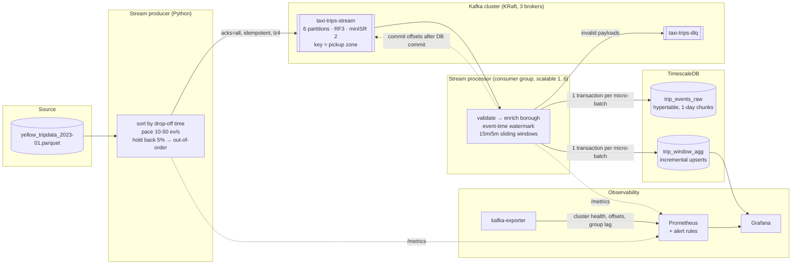
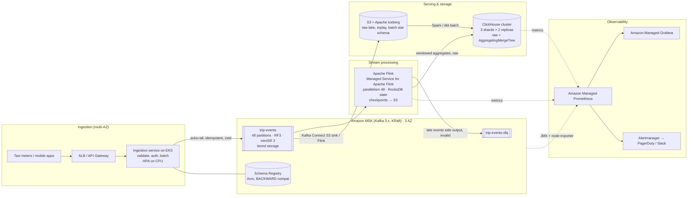

# Assignment 2 — Real-time NYC Taxi Streaming Pipeline

A local, fully containerised real-time pipeline:

**NYC TLC parquet → Python stream producer → 3-broker Kafka (KRaft) → Python stream processor (event-time sliding windows) → TimescaleDB → Prometheus + Grafana**

| Component | Technology | Local endpoint |
|---|---|---|
| Message broker | Apache Kafka 3.9, 3 nodes, KRaft (no ZooKeeper) | `localhost:9092,9093,9094` |
| Topics | `taxi-trips-stream` (6 partitions, RF 3, min ISR 2), `taxi-trips-dlq` (3 partitions) | — |
| Stream producer | Python, `confluent-kafka` (librdkafka) | metrics `localhost:8000` |
| Stream processor | Python, `confluent-kafka`, consumer group `taxi-stream-processor` | metrics `:8001` per replica |
| Storage / OLAP | TimescaleDB 2.14 (PostgreSQL 16): raw hypertable + window aggregates | `localhost:15433` |
| Metrics | Prometheus 2.54 + kafka-exporter + app metrics, alert rules | `http://localhost:9090` |
| Dashboards | Grafana 11 (provisioned datasources + dashboard) | `http://localhost:3300` (admin/admin) |
| Kafka UI (optional) | provectus kafka-ui | `http://localhost:8088` |

---

## 1. Local architecture



### Data flow in one sentence per hop

1. **Producer** reads the month's trips, drops unusable rows, sorts them by drop-off time (= event time) and replays them at 10–50 events/s (a sine "traffic wave" by default). 5 % of events are held back for 1–30 s to create genuine out-of-order arrival. Each event gets a **deterministic UUID** derived from its source row, and is keyed by pickup zone.
2. **Kafka** stores the stream durably on 3 brokers (RF 3, `min.insync.replicas=2`, `acks=all`), so losing any one broker loses no acknowledged data and doesn't stop writes.
3. **Stream processor** consumes micro-batches, validates (bad payloads → DLQ), enriches the borough from the zone lookup, tracks a per-partition **event-time watermark**, and computes **15-minute sliding windows that advance every 5 minutes**, per pickup borough plus a city-wide `ALL` row.
4. **TimescaleDB** receives, in a single transaction per batch, the raw events (idempotent insert) and the window **upserts** (additive increments). Kafka offsets are committed only after that transaction commits.
5. **Prometheus** scrapes kafka-exporter (cluster + consumer group lag) and both applications; **Grafana** shows cluster health, consumer lag, throughput/latency and the window results.

---

## 2. Running it

### Prerequisites

* Docker Desktop / Docker Engine with Compose v2, ~4 GB free RAM (3 brokers × 512 MB heap + the rest).
* The trip data in `../data/raw/` — the Assignment 1 setup script already downloads it. Stand-alone:

```bash
../assignment-1-batch-etl/setup.sh --download-only --months "2023-01"
```

If the file is missing, the producer falls back to a built-in synthetic generator (logged as `source.missing_using_synthetic`), so the pipeline is demoable offline.

### Start everything

```bash
cp .env.example .env            # optional, defaults are fine
docker compose up -d --build
docker compose ps               # kafka-init should be "exited (0)"
```

Open Grafana at <http://localhost:3300> — the **NYC Taxi – Streaming Pipeline** dashboard is the home page.

### Stage-by-stage demo (if the machine can't run everything at once)

> On Windows **Git Bash**, prefix `docker exec` commands that contain container paths with `MSYS_NO_PATHCONV=1`
> (otherwise `/opt/kafka/...` is rewritten to a Windows path), or run them from PowerShell.

```bash
# Stage 1 – Kafka cluster + topics
docker compose up -d kafka-1 kafka-2 kafka-3 kafka-init
docker compose logs kafka-init                     # shows the topic descriptions (leaders, ISR)
docker exec kafka-1 /opt/kafka/bin/kafka-metadata-quorum.sh --bootstrap-server kafka-1:19092 describe --status

# Stage 2 – producer only; watch messages arrive
docker compose up -d producer
docker exec kafka-1 /opt/kafka/bin/kafka-console-consumer.sh --bootstrap-server kafka-1:19092 \
    --topic taxi-trips-stream --property print.key=true --property print.partition=true --max-messages 5

# Stage 3 – storage + processor
docker compose up -d timescaledb stream-processor
docker exec kafka-1 /opt/kafka/bin/kafka-consumer-groups.sh --bootstrap-server kafka-1:19092 \
    --describe --group taxi-stream-processor

# Stage 4 – observability
docker compose up -d kafka-exporter prometheus grafana
```

### Inspect the results

```bash
docker exec -it taxi-timescaledb psql -U taxi -d taxi_stream
```

```sql
-- latest closed windows, city-wide
SELECT window_start, window_end, trip_count, total_revenue, fare_per_mile
FROM v_trip_window_metrics WHERE pu_borough = 'ALL' AND is_final
ORDER BY window_end DESC LIMIT 10;

-- how much arrived late, per partition
SELECT kafka_partition, count(*) FILTER (WHERE is_late) AS late, count(*) AS total
FROM trip_events_raw GROUP BY 1 ORDER BY 1;
```

### Resilience drills (good to show live)

Verified on this setup: scale-out to 3 replicas, loss of one broker, a 40-second database outage, a poison message,
and crash/redelivery (processors restarted mid-batch; row counts stayed exact). The two-broker case is the expected
behaviour of `min.insync.replicas=2` and was not part of the recorded run.

| Drill | Command | What you should see |
|---|---|---|
| Scale out the consumer group | `docker compose up -d --scale stream-processor=3` | Cooperative rebalance in the logs; Grafana "Consumer group members" = 3; Prometheus discovers the replicas via DNS. |
| Lose a broker | `docker stop kafka-2` | `KafkaUnderReplicatedPartitions` fires, ISR drops to 2, the producer keeps writing (min ISR 2 still met). `docker start kafka-2` → ISR recovers. |
| Lose two brokers | `docker stop kafka-2 kafka-3` | `acks=all` writes are refused (`NOT_ENOUGH_REPLICAS`) — durability over availability. The producer buffers and retries; nothing is lost when brokers return. |
| Database outage → backpressure | `docker stop taxi-timescaledb` (≤ 2 min) | `DB backpressure = BLOCKED`, consumer lag grows while Kafka buffers, then drains after `docker start taxi-timescaledb`. No duplicates in the DB. |
| Crash between DB commit and offset commit | `docker kill <processor>` mid-run | On restart the batch is redelivered; `taxi_processor_events_total{outcome="duplicate"}` rises, aggregates stay correct. |
| Poison message | `echo 'not-json' \| docker exec -i kafka-1 /opt/kafka/bin/kafka-console-producer.sh --bootstrap-server kafka-1:19092 --topic taxi-trips-stream` | Routed to `taxi-trips-dlq` with `error`/`source_offset` headers; the stream does not stall. |

### Running the Python apps outside Docker

```bash
python -m venv .venv && source .venv/bin/activate      # Windows: .venv\Scripts\activate
pip install -r requirements.txt pytest
pytest                                                  # windowing / watermark / event contract tests
docker compose up -d kafka-1 kafka-2 kafka-3 kafka-init timescaledb
PRODUCER_SOURCE_FILE=../data/raw/yellow_tripdata_2023-01.parquet python -m streaming.producer
python -m streaming.processor                           # defaults: localhost:9092-9094, TimescaleDB on 15433
```

---

## 3. Kafka configuration — and why

### Cluster (docker-compose.yml)

| Setting | Value | Reason |
|---|---|---|
| Mode | KRaft, 3 combined broker+controller nodes | No ZooKeeper; 3 voters tolerate 1 failure. In production controllers are dedicated nodes. |
| `default.replication.factor` / `min.insync.replicas` | 3 / 2 | With `acks=all`, a write is acknowledged only once 2 replicas have it → survives a broker loss without data loss, and still accepts writes with one broker down. |
| `unclean.leader.election.enable` | false | Never elect an out-of-sync replica as leader (which would silently lose acknowledged messages). |
| `auto.create.topics.enable` | false | Topics are created explicitly with reviewed settings (`kafka/create-topics.sh`), not by a typo in a client. |
| `offsets.topic.replication.factor`, transaction log RF | 3 | Internal topics as durable as the data. |
| Listeners | `INTERNAL` (container network), `EXTERNAL` (host), `CONTROLLER` | Containers use `kafka-N:19092`, host tools use `localhost:9092-9094`. |

### Topic `taxi-trips-stream`

| Setting | Value | Reason |
|---|---|---|
| Partitions | 6 | Unit of parallelism: up to 6 processor replicas. Leaves headroom over the 10–50 ev/s demo rate; a multiple of 3 brokers so leadership balances evenly. |
| Key | pickup `LocationID` | Per-zone ordering, ~260 distinct keys spread evenly over partitions (visible in "Topic write rate by partition"). |
| `retention.ms` | 7 days | Replay window for reprocessing / backfills after a downstream bug. |
| `compression.type` | `producer` | The broker keeps the producer's lz4 batches as-is (no recompression CPU). |
| DLQ `taxi-trips-dlq` | 3 partitions, 14 days | Invalid events kept long enough to investigate and replay. |

### Producer

| Setting | Value | Reason |
|---|---|---|
| `acks` | `all` | Durability (see min ISR). |
| `enable.idempotence` | true | Broker de-duplicates producer retries and keeps per-partition order (sequence numbers). |
| `linger.ms` / `batch.size` | 20 ms / 64 KB | Small batching window — trades ≤20 ms latency for far fewer requests. |
| `compression.type` | lz4 | Cheap CPU, ~2–4× smaller JSON on the wire and on disk. |
| `queue.buffering.max.messages` | 100 000 | Bounded local buffer. When full, `produce()` raises `BufferError` and the producer blocks on `poll()` → backpressure instead of unbounded memory or dropped data (`taxi_producer_buffer_full_total`). |
| Record timestamp | produce time (not event time) | Setting 2023 event times as record timestamps would make the 7-day time-based retention delete segments immediately. Event time travels in the payload. |

### Consumer (stream processor)

| Setting | Value | Reason |
|---|---|---|
| `enable.auto.commit` | false | Offsets committed manually, **after** the DB transaction → no data loss on crash. |
| `auto.offset.reset` | earliest | A new group processes the full retained stream. |
| `partition.assignment.strategy` | cooperative-sticky | Incremental rebalances: scaling or a restart doesn't stop all consumers ("stop-the-world"). |
| `max.poll.interval.ms` | 300 000 | The DB retry budget (120 s) stays well below it, so a slow DB never gets the consumer kicked out of the group mid-batch. |
| `queued.max.messages.kbytes` | 16 MB | Bounds librdkafka's prefetch queue → flat memory under backpressure. |

---

## 4. Stream processing design

### Event time, sliding windows, watermarks

* **Event time** = trip drop-off time (the moment the "trip completed" event happens), carried in the payload. Processing never uses wall-clock time for windowing, so replays give identical results.
* **Sliding windows**: size 15 min, slide 5 min (`WINDOW_SIZE_SECONDS`, `WINDOW_SLIDE_SECONDS`). Each event belongs to 3 overlapping windows. Aggregated per pickup borough plus a city-wide `ALL` row: trips, passengers, distance, fare, tip, revenue; the view `v_trip_window_metrics` derives fare/mile, revenue/trip, tip %.
* **Watermark** = `min over this consumer's partitions( max event time seen in partition ) − allowed lateness (10 min)`. Taking the minimum across partitions means a fast partition can't make a slower partition's events look late.
* **Window lifecycle**: a window is *open* until the watermark passes its end, then it is marked `is_final = true`. Events arriving for still-open windows update them (that's how out-of-order data within the lateness bound is handled correctly); events whose windows are **all** closed are **late**: stored raw with `is_late = true`, counted in `taxi_processor_events_total{outcome="late"}`, and not applied to final windows (so published numbers don't change after they are final).
* **Clock outliers**: TLC data contains a few timestamps years off. Producer filters events outside the file's month; the processor additionally refuses to let a timestamp > 1 h ahead of a partition's max advance the watermark (`taxi_processor_clock_outliers_total`) — otherwise one bad clock would make every following event "late".

With the producer defaults (5 % of events delayed 1–30 s of wall-clock ≈ several minutes of event time at the replay speed), most delayed events land inside the 10-minute lateness bound and correct their windows; the rest are measurably late — tune `ALLOWED_LATENESS_SECONDS` and watch the "Late events" panel react.

### Exactly-once *effect* with at-least-once delivery

Per micro-batch, in one PostgreSQL transaction:

1. `INSERT … ON CONFLICT (event_id, event_time) DO NOTHING RETURNING event_id` — the returned ids are the events that are genuinely new;
2. only those new, on-time events are folded into window deltas;
3. `INSERT … ON CONFLICT DO UPDATE SET trip_count = trip_count + EXCLUDED.trip_count, …` (additive upsert);
4. windows behind the watermark are marked final;

then the Kafka offsets are committed. A crash anywhere before the offset commit causes redelivery, but redelivered events conflict in step 1 and are never re-aggregated. Combined with the deterministic event ids from the producer, even a full producer replay of the same file doesn't double count. Window rows are upserted in sorted key order so concurrent processor replicas lock rows in the same order, and window finalisation uses `FOR UPDATE SKIP LOCKED` (a row another replica is upserting is simply finalised by a later batch) — together this removes the deadlocks that a naive multi-row `UPDATE` produced when running 3 replicas. Any remaining transient error (deadlock, serialization failure, lost connection) is retried.

### Backpressure, end to end

| Where | Mechanism |
|---|---|
| Producer → Kafka | Bounded librdkafka queue; `BufferError` → block on `poll()` until deliveries complete. `linger.ms` batching. |
| Kafka | The log *is* the buffer: 7 days of retention absorbs consumer outages. |
| Kafka → processor | Pull-based: the next batch is fetched only after the current one is committed; bounded prefetch queue (`queued.max.messages.kbytes`). |
| Processor → DB | Exponential-backoff retries (0.5 s → 10 s, 120 s budget) while `taxi_processor_db_backpressure = 1`; past the budget the process exits, Docker restarts it and the batch is reprocessed idempotently. |
| Signals | `ConsumerLagHigh`, `ConsumerLagGrowing`, `DatabaseBackpressure` alerts; scale out with `--scale stream-processor=N` (≤ partitions). |

### Data model (TimescaleDB)

* `trip_events_raw` — hypertable on `event_time` (1-day chunks), PK `(event_id, event_time)`, Kafka coordinates (`kafka_partition`, `kafka_offset`) for lineage, `is_late` flag. Compression is configured (`segmentby pu_borough`); a compression policy is intentionally **not** enabled locally because the replayed 2023 chunks would be compressed immediately.
* `trip_window_agg` — PK `(window_start, window_end, pu_borough)`, additive measures, `is_final`, `update_count` (how many micro-batches touched the window), partial index on open windows.
* `v_trip_window_metrics` — ratios for Grafana.

---

## 5. Observability

### Metrics

| Source | Key metrics |
|---|---|
| kafka-exporter | `kafka_brokers`, `kafka_topic_partition_under_replicated_partition`, `kafka_topic_partition_in_sync_replica`, `kafka_topic_partition_leader`, `kafka_topic_partition_current_offset`, `kafka_consumergroup_lag`, `kafka_consumergroup_members` |
| Producer `:8000` | `taxi_producer_events_sent_total`, `…_delivery_failures_total{reason}`, `…_delivery_latency_seconds`, `…_buffer_full_total`, `…_target_rate`, `…_held_back_events`, `…_out_of_order_injected_total`, `…_queue_length` |
| Processor `:8001` | `taxi_processor_messages_consumed_total`, `…_events_total{outcome=inserted\|late\|duplicate\|invalid}`, `…_end_to_end_latency_seconds`, `…_batch_duration_seconds`, `…_batch_size`, `…_watermark_timestamp_seconds`, `…_consumer_lag{partition}`, `…_db_backpressure`, `…_db_errors_total`, `…_dlq_messages_total`, `…_window_rows_upserted_total`, `…_windows_finalized_total` |

### Grafana dashboard (`monitoring/grafana/dashboards/taxi-streaming.json`)

1. **Kafka cluster health** — brokers online, under-replicated partitions, partitions without leader, min ISR, firing alerts, scrape-target health, write rate per partition.
2. **Consumer lag** — group lag per partition (committed offsets, from kafka-exporter), total lag, group members, DB backpressure, per-instance lag (from the processor).
3. **Pipeline throughput & latency** — produced vs consumed vs target rate, events by outcome (inserted/late/duplicate/invalid), end-to-end latency p50/p95/p99, micro-batch duration, producer ack latency.
4. **Event time & windows** — current watermark, late-event ratio, events held back, DLQ count, the latest sliding windows per borough (open/final), city-wide trips per window, raw table counts.

### Alerts (`monitoring/prometheus/alerts.yml`)

`KafkaBrokerDown`, `KafkaUnderReplicatedPartitions`, `KafkaPartitionWithoutLeader`, `KafkaExporterDown`, `ConsumerLagHigh`, `ConsumerLagGrowing`, `StreamProcessorDown`, `ProducerStalled`, `ProducerDeliveryFailures`, `DatabaseBackpressure`, `HighLateEventRatio`, `DeadLetterEvents`, `EndToEndLatencyHigh` — visible at <http://localhost:9090/alerts>. In production they route through Alertmanager to Slack/PagerDuty.

---

## 6. Assumptions & trade-offs

* **Event = completed trip**, event time = drop-off time. Timestamps in the TLC files are NYC local time without zone; they are treated as UTC-labelled to avoid DST ambiguity in the demo (in production: localise with `America/New_York` at the source).
* **Replay speed**: real January traffic is ~1.2 trips/s; replaying at 10–50 ev/s compresses event time ~10–40×, so a 15-minute window fills in well under a minute of wall-clock time — convenient for a live demo.
* **JSON** payloads keep the demo inspectable with console tools; production uses Avro/Protobuf + Schema Registry (smaller, typed, compatibility-checked).
* **Python consumer instead of Flink/Spark**: the assignment allows native Kafka-Python. The window/watermark logic is deliberately explicit (`streaming/windowing.py`) so it can be explained line by line; the production design below moves it to Flink.
* **Finalisation across replicas**: each replica's watermark covers only its own partitions; when scaled out, `is_final` is set by whichever replica's watermark passes the window end first (advisory). Additive upserts keep the *numbers* correct regardless. A global watermark (Flink) removes this caveat.
* **Combined KRaft nodes** and 512 MB heaps to fit a laptop; production separates controllers and sizes brokers as below.

---

## 7. Production architecture — scaling to 50,000 events/second (AWS)

### 7.1 Requirements & sizing assumptions

| Item | Assumption |
|---|---|
| Sustained / peak load | 50 000 ev/s sustained, design for **2× peak (100 000 ev/s)** |
| Event size | ~250 B Avro (≈ 450 B JSON today); budget **1 KB** to stay safe with schema growth |
| Ingress | 50 k × 1 KB = **50 MB/s** sustained, 100 MB/s peak (4.3 TB/day) |
| Durability | No acknowledged event lost on a single-AZ failure; RPO ≤ 5 min on regional failure |
| Latency SLO | p99 event → queryable aggregate < **5 s**; dashboards refresh ≤ 10 s |
| Retention | 7 days replayable in Kafka; raw history forever in the lake |

### 7.2 Target architecture



### 7.3 Kafka (Amazon MSK provisioned, or Confluent Cloud)

* **Partitions: 48.** Rule of thumb ≤ ~5 MB/s per partition for comfortable consumer parallelism: 100 MB/s peak ÷ 5 MB/s = 20 → 48 gives 2.4× headroom for growth, divides evenly across 6 brokers / 3 AZs, and matches Flink parallelism 48. Partition count is hard to change for keyed topics (re-keying shuffles ordering), so over-provision once.
* **Keying:** `pickup_zone_id` (~260 keys) is too coarse at 50 k/s — hot zones (JFK, Midtown) would create hot partitions. Key by `vehicle_id` (ordering per vehicle is the real requirement) and aggregate per zone in Flink.
* **Brokers:** 6 × `kafka.m7g.2xlarge` (2 per AZ), rack-aware replica placement so each partition's 3 replicas sit in 3 AZs. Write load: 50 MB/s × RF 3 = 150 MB/s cluster-wide (≈ 25 MB/s per broker sustained, 50 MB/s at peak) — well inside broker network/EBS limits, leaving room for 3–4 consumer groups of read fan-out.
* **Storage:** 4.3 TB/day × RF 3 ≈ 13 TB/day. Keep **24 h on local gp3** (~2.2 TB per broker → provision 3 TB with headroom) and the rest of the 7 days in **MSK tiered storage** (S3-backed), which is much cheaper and makes broker replacement fast.
* **Controllers:** dedicated KRaft controller quorum (3 nodes) — managed by MSK.
* **Durability settings:** RF 3, `min.insync.replicas=2`, `unclean.leader.election.enable=false`, producers `acks=all` + idempotence.
* **Producer tuning at scale:** `linger.ms=10–20`, `batch.size=256–512 KB`, `compression.type=zstd`, `max.in.flight.requests.per.connection=5` (safe with idempotence), sticky partitioning for unkeyed data.
* **Quotas & isolation:** per-client produce/fetch quotas so a backfill job can't starve real-time consumers; separate topics for DLQ and late events.
* **Schema Registry** (Glue Schema Registry or Confluent SR): Avro with `BACKWARD` compatibility enforced in CI → producers can't break consumers.

### 7.4 Stream processing — Apache Flink

* **Managed Service for Apache Flink** (or Flink Kubernetes Operator on EKS), parallelism 48 (one subtask per partition), ~12 KPUs / task managers with 4 slots each at the start, autoscaling on backpressure/CPU.
* **Event time & out-of-order:** `WatermarkStrategy.forBoundedOutOfOrderness(2 min).withIdleness(1 min)` — the idleness timeout fixes the "idle partition holds back the watermark" problem that the local Python version only documents. `SlidingEventTimeWindows.of(15 min, 5 min)` with `allowedLateness(10 min)`; events later than that go to a **side output** (late-events topic + lake) instead of being dropped silently.
* **State:** RocksDB state backend, incremental checkpoints every 30–60 s to S3; savepoints for zero-loss upgrades (blue/green job deploys).
* **Exactly-once:** Kafka source offsets live in checkpoints; sinks are either transactional (two-phase-commit Kafka sink) or **idempotent upserts** (ClickHouse `ReplacingMergeTree` keyed by window + borough, versioned by window update time) — the same "idempotent sink" principle as the local version.
* **Backpressure:** Flink's credit-based flow control propagates slowness from sink to source automatically; Kafka absorbs the rest. Monitor `backPressuredTimeMsPerSecond`, checkpoint duration/size, and consumer lag.

### 7.5 Storage & serving

* **ClickHouse** (ClickHouse Cloud or self-managed on EC2, 3 shards × 2 replicas): raw events in `MergeTree` partitioned by day, ordered by `(borough, event_time)`, TTL-moved to S3 after 30 days; windowed aggregates in `AggregatingMergeTree`/`ReplacingMergeTree`. Inserts batched ≥ 10 k rows (or `async_insert`) — ClickHouse ingests millions of rows/s, so 50 k ev/s is comfortable. Chosen over TimescaleDB at this scale for columnar compression (~10×) and sub-second scans over billions of rows.
* **Lake:** Kafka Connect S3 sink (or a Flink job) writes the raw stream to **Apache Iceberg** on S3 (hourly partitions). This is the system of record for replays/backfills, and the source for the Assignment 1 style batch star schema (Spark/dbt, orchestrated by Airflow/Dagster).
* **Dashboards:** Grafana for operations, Superset for analysts, both reading ClickHouse.

### 7.6 Reliability & operations

| Concern | Design |
|---|---|
| AZ failure | 3-AZ MSK with rack-aware RF 3 / minISR 2; Flink restarts from the last checkpoint; ClickHouse replicas in different AZs. |
| Region failure | MSK Replicator / MirrorMaker 2 to a standby region (RPO minutes); Iceberg tables replicated via S3 CRR; IaC can rebuild the compute side. |
| Deployments | Terraform for infrastructure, Helm/ArgoCD for services; Flink upgrades via savepoint → new job → verify → switch. Consumer changes can shadow-run under a new group id before cut-over. |
| Poison data | Schema validation at ingestion; DLQ with error headers + a replay tool; alert on DLQ rate. |
| Capacity testing | `kafka-producer-perf-test` and a replay of real traffic at 2× peak before go-live; chaos drills (broker kill, AZ blackhole, sink outage) every quarter. |
| Autoscaling | Ingestion pods via HPA; Flink autoscaler; any remaining plain consumers via **KEDA on consumer lag**. |

### 7.7 Observability at scale

* **Metrics:** MSK open monitoring (JMX + node exporter) → Amazon Managed Prometheus; Flink and ClickHouse exporters; consumer lag via kafka-exporter/Burrow (or MSK's lag metrics in CloudWatch).
* **Golden signals & SLOs:** ingest rate vs. processed rate, end-to-end p99 latency (event timestamp → visible in ClickHouse), consumer lag in *seconds* (time-to-drain), error/DLQ ratio, under-replicated / offline partitions, checkpoint failures. Multi-window burn-rate alerts on the latency SLO.
* **Logs & traces:** JSON logs → CloudWatch/OpenSearch; OpenTelemetry trace context in Kafka headers for sampled end-to-end tracing.

### 7.8 Security & governance

* Private subnets only; clients reach MSK over PrivateLink/VPC peering. TLS in transit everywhere; KMS encryption at rest.
* IAM authentication (or SASL/SCRAM) with least-privilege ACLs per service principal (producer: write `trip-events`; Flink: read `trip-events`, write `dlq`).
* Secrets in AWS Secrets Manager; no credentials in images.
* PII (pickup/drop-off precision tied to a person) handled by policy: coarse zones in analytics, raw retention limits, access audited.

### 7.9 Local → production mapping

| Local (this repo) | Production |
|---|---|
| 3 combined KRaft nodes in Docker | MSK, 6 brokers in 3 AZs + dedicated controllers, tiered storage |
| 6 partitions, key = pickup zone | 48 partitions, key = vehicle id |
| JSON + `schema_version` field | Avro + Schema Registry (BACKWARD) |
| Python processor, explicit watermark logic | Flink, `forBoundedOutOfOrderness` + `withIdleness`, RocksDB, S3 checkpoints |
| Idempotent upsert into TimescaleDB | Idempotent upsert into ClickHouse (ReplacingMergeTree) + Iceberg lake |
| Prometheus + Grafana in Docker | Amazon Managed Prometheus + Managed Grafana + Alertmanager/PagerDuty |
| `docker compose --scale` | Flink autoscaler, KEDA on lag, HPA |

---

## 8. Repository layout

```
assignment-2-streaming/
├── docker-compose.yml            # Kafka x3 (KRaft), topic init, TimescaleDB, apps, Prometheus, Grafana
├── Dockerfile                    # image for producer + processor
├── kafka/create-topics.sh        # explicit topic creation (partitions, RF, retention)
├── sql/init.sql                  # hypertable, window aggregate table, view
├── streaming/
│   ├── config.py                 # env-driven settings
│   ├── events.py                 # event contract, validation, deterministic ids
│   ├── producer.py               # parquet replay, pacing, out-of-order injection, backpressure
│   ├── windowing.py              # sliding windows, watermarks, aggregation (pure logic)
│   ├── sink.py                   # TimescaleDB writes (idempotent insert, additive upsert)
│   ├── processor.py              # consumer loop, DLQ, offset management, metrics
│   └── logging_utils.py          # JSON logs
├── monitoring/
│   ├── prometheus/{prometheus.yml,alerts.yml}
│   └── grafana/{provisioning/,dashboards/taxi-streaming.json}
└── tests/                        # windowing + event contract unit tests
```
